# Wambach Audio plugin downloads

Installers for Wambach Audio plugins.

- **macOS** (`.pkg`): Audio Unit, VST3 and standalone app. Runs on Apple
  Silicon and Intel Macs, macOS 11 or later.
- **Windows** (`.exe`): VST3 and standalone app. 64-bit Windows.

## Cut It

A noise reducer for steady background noise such as tape hiss, air
conditioning and ventilation. Play it a short noise-only section to learn
the noise, then dial in how much to remove. A Difference switch lets you
hear exactly what's being taken out.

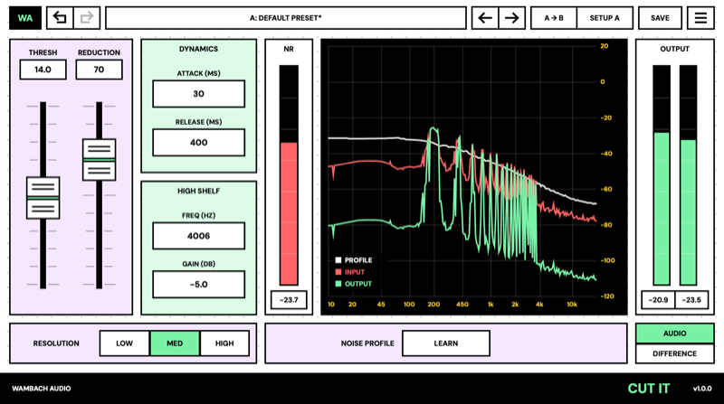

[CutIt-mac.pkg](https://github.com/scwambach/wambach-audio-releases/releases/download/cut-it-latest/CutIt-mac.pkg) | [CutIt-win.exe](https://github.com/scwambach/wambach-audio-releases/releases/download/cut-it-latest/CutIt-win.exe)

## FirePressor

A channel strip with a tube preamp and a limiter: input trim, drive,
threshold and makeup, plus an 80 Hz filter.

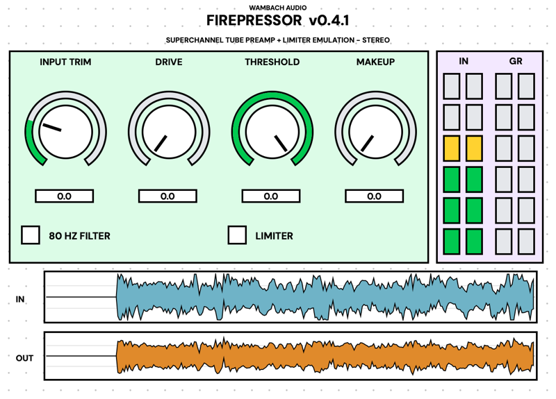

[FirePressor-mac.pkg](https://github.com/scwambach/wambach-audio-releases/releases/download/fire-pressor-latest/FirePressor-mac.pkg) | [FirePressor-win.exe](https://github.com/scwambach/wambach-audio-releases/releases/download/fire-pressor-latest/FirePressor-win.exe)

## Get The Ess Outta Here

A de-esser that tames harsh "s" sounds, with a live graph showing what gets
reduced. Mono or stereo.

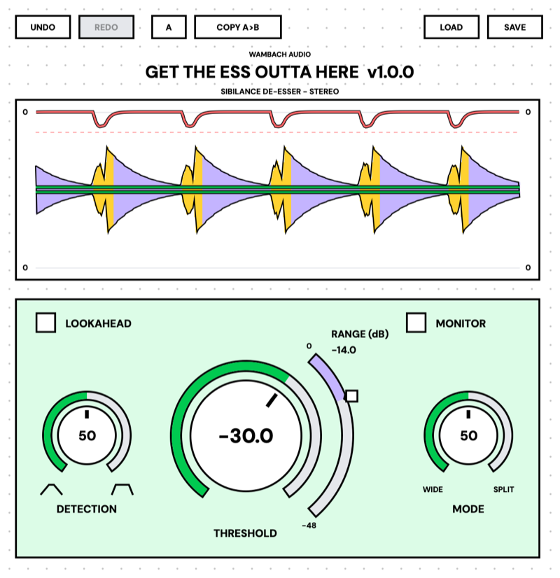

[GetTheEssOuttaHere-mac.pkg](https://github.com/scwambach/wambach-audio-releases/releases/download/get-the-ess-outta-here-latest/GetTheEssOuttaHere-mac.pkg) | [GetTheEssOuttaHere-win.exe](https://github.com/scwambach/wambach-audio-releases/releases/download/get-the-ess-outta-here-latest/GetTheEssOuttaHere-win.exe)

## lil-freq

A dynamic EQ you draw right on a live spectrum. Place up to 24 bands by
hand, make any of them dynamic, and see where two tracks are fighting over
the same frequencies.

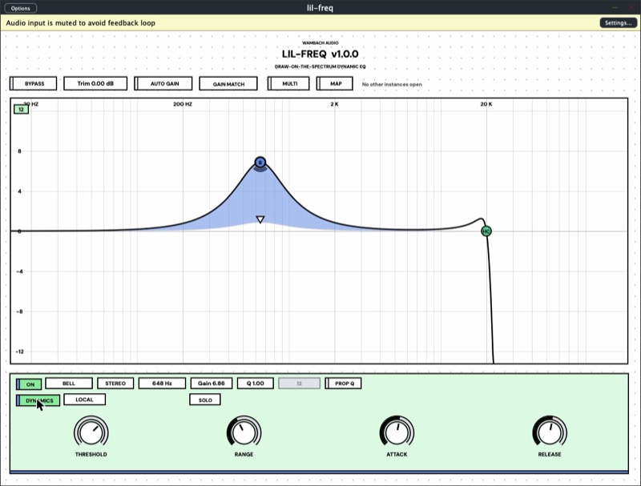

[lil-freq-mac.pkg](https://github.com/scwambach/wambach-audio-releases/releases/download/lil-freq-latest/lil-freq-mac.pkg) | [lil-freq-win.exe](https://github.com/scwambach/wambach-audio-releases/releases/download/lil-freq-latest/lil-freq-win.exe)

## Make Big

An all-in-one mastering processor. Seven modules in signal order (Input,
EQ, Dynamics, Glue, Width, Color and Loud) with full metering, plus a live
view of the reactive EQ on the EQ page.

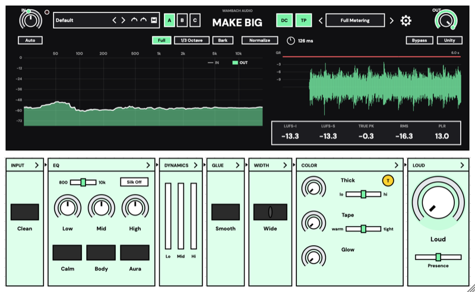

[MakeBig-mac.pkg](https://github.com/scwambach/wambach-audio-releases/releases/download/make-big-latest/MakeBig-mac.pkg) | [MakeBig-win.exe](https://github.com/scwambach/wambach-audio-releases/releases/download/make-big-latest/MakeBig-win.exe)

## Referencer

A reference-track A/B tool for the end of your master bus. Flip between your
mix and a commercial track while comparing spectrum, loudness and stereo
meters side by side.

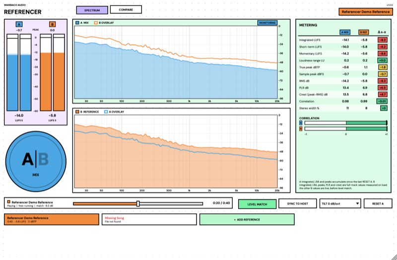

[Referencer-mac.pkg](https://github.com/scwambach/wambach-audio-releases/releases/download/referencer-latest/Referencer-mac.pkg) | [Referencer-win.exe](https://github.com/scwambach/wambach-audio-releases/releases/download/referencer-latest/Referencer-win.exe)

## Room Mics

Room microphones for close-miked drums, guitar and vocals. Each drum gets its
own instance and a place in a real-sized room. Two mic pairs (spaced, XY,
ORTF or mid-side) hear the room's reflections and tail. Drag the source, mics
and walls in the room view, link a whole kit with room groups, and crush the
room with the bus compressor and a gate that blooms on slow hits.

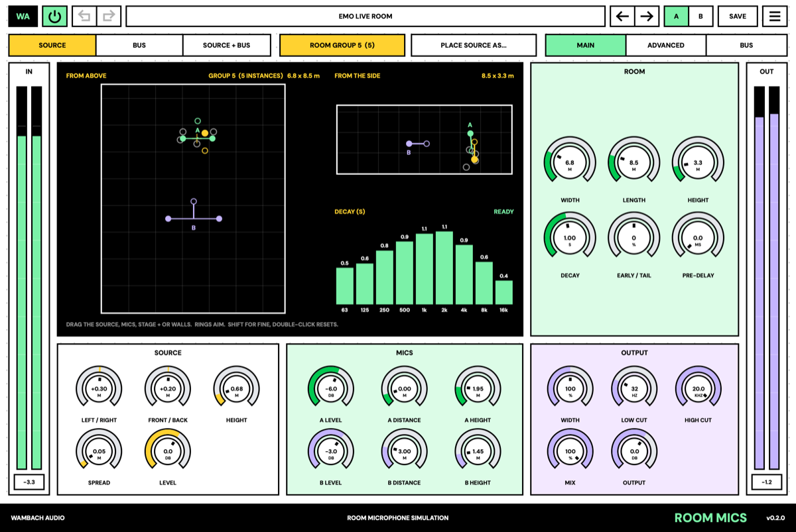

[RoomMics-mac.pkg](https://github.com/scwambach/wambach-audio-releases/releases/download/room-mics-latest/RoomMics-mac.pkg) | [RoomMics-win.exe](https://github.com/scwambach/wambach-audio-releases/releases/download/room-mics-latest/RoomMics-win.exe)

## Spread 'Em

A stereo widener for sources that are already panned, like a guitar bus
panned hard left and right. Pushes the sides further apart, clears room in
the middle and keeps the bass in mono.

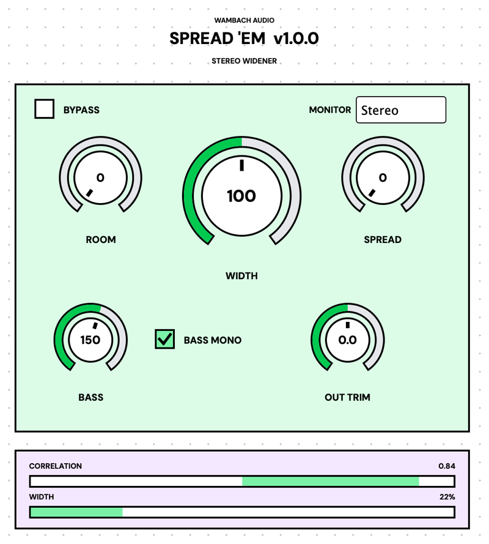

[SpreadEm-mac.pkg](https://github.com/scwambach/wambach-audio-releases/releases/download/spread-em-latest/SpreadEm-mac.pkg) | [SpreadEm-win.exe](https://github.com/scwambach/wambach-audio-releases/releases/download/spread-em-latest/SpreadEm-win.exe)

## Stop Crowdin' Me

Makes room for a vocal in a busy mix. Put it on the guitars or music bus and
feed it the vocal: it dips the music only in the frequencies the vocal is
using, only while the vocal is there. Plugin only, no standalone app.

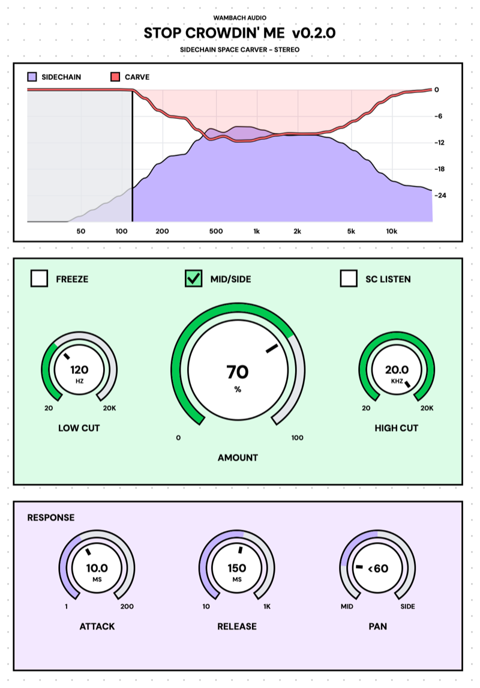

[StopCrowdinMe-mac.pkg](https://github.com/scwambach/wambach-audio-releases/releases/download/stop-crowdin-me-latest/StopCrowdinMe-mac.pkg) | [StopCrowdinMe-win.exe](https://github.com/scwambach/wambach-audio-releases/releases/download/stop-crowdin-me-latest/StopCrowdinMe-win.exe)

## StressedOut

A character compressor with eight named curves, from Color (1:1) up to an
all-out Nuke. Pick a curve by its shape, watch the signal ride it on a live
curve graph, and add Warm or Grit harmonics. Includes a before/after display.

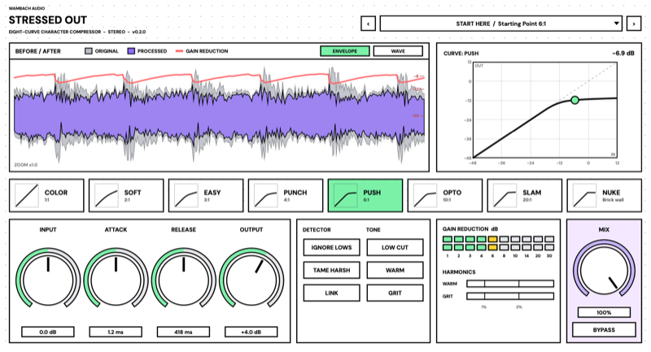

[StressedOut-mac.pkg](https://github.com/scwambach/wambach-audio-releases/releases/download/stressed-out-latest/StressedOut-mac.pkg) | [StressedOut-win.exe](https://github.com/scwambach/wambach-audio-releases/releases/download/stressed-out-latest/StressedOut-win.exe)

## Verbox SCW85

A digital reverb and effects processor based on a classic rack unit, with
several algorithms. A Simple view keeps it to decay, size, pre-delay, tone
and mix; the Advanced view gives detailed control over decay, diffusion and
tone.

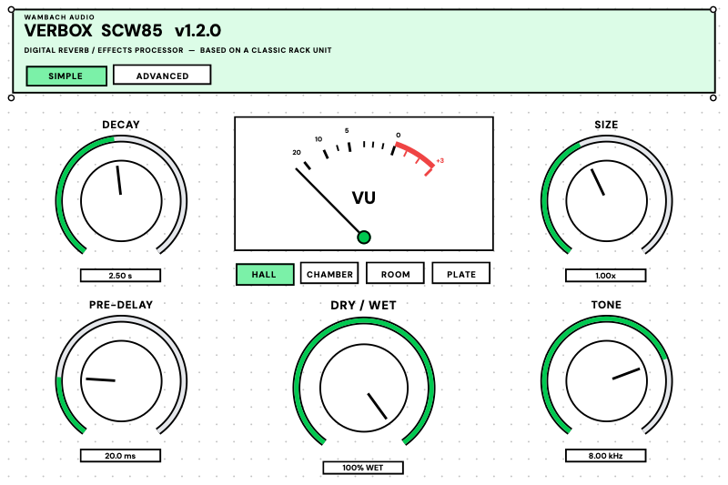

[VerboxSCW85-mac.pkg](https://github.com/scwambach/wambach-audio-releases/releases/download/verbox-scw85-latest/VerboxSCW85-mac.pkg) | [VerboxSCW85-win.exe](https://github.com/scwambach/wambach-audio-releases/releases/download/verbox-scw85-latest/VerboxSCW85-win.exe)

## Vintage Tape

A reel-to-reel tape machine for the master bus or any track: saturation,
compression, head bump, wow and flutter, hiss and worn-tape character.

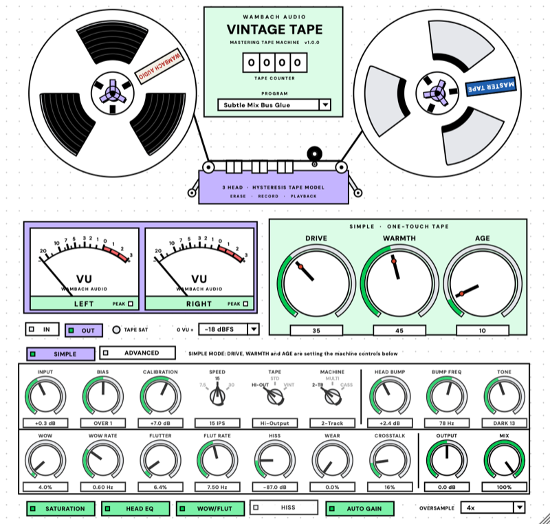

[VintageTape-mac.pkg](https://github.com/scwambach/wambach-audio-releases/releases/download/vintage-tape-latest/VintageTape-mac.pkg) | [VintageTape-win.exe](https://github.com/scwambach/wambach-audio-releases/releases/download/vintage-tape-latest/VintageTape-win.exe)

## VocalDoubler

Turns a single vocal into a wider, thicker double with up to four voices,
each with its own gain, pan, delay, detune and modulation. Plugin only, no
standalone app.

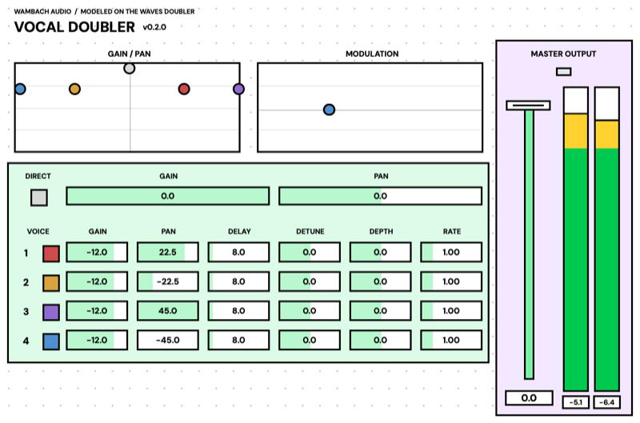

[VocalDoubler-mac.pkg](https://github.com/scwambach/wambach-audio-releases/releases/download/wamvox-doubler-latest/VocalDoubler-mac.pkg) | [VocalDoubler-win.exe](https://github.com/scwambach/wambach-audio-releases/releases/download/wamvox-doubler-latest/VocalDoubler-win.exe)

## WA Drummer

A drum sampler with five drummers' kits in one instrument (Punk, Indie,
Alternative, Hardcore and Pop), plus a Builder mode that mixes and matches
their kicks, snares and toms. Every one of the thirteen pads has its own
tune, pan, 12-band channel EQ, compressor, distortion, bit crusher and
stereo/mono switch, and can go out on its own channel for multitrack
recording. The installer also installs the drum sample library (about
650 MB once installed).

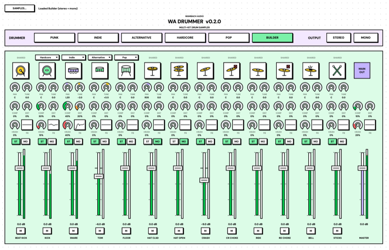

[WADrummer-mac.pkg](https://github.com/scwambach/wambach-audio-releases/releases/download/wa-drummer-latest/WADrummer-mac.pkg) | [WADrummer-win.exe](https://github.com/scwambach/wambach-audio-releases/releases/download/wa-drummer-latest/WADrummer-win.exe)

## WambEcho

A vintage tape echo with four switchable tape heads, wow and flutter,
saturation, a de-esser, diffusion reverb and true ping pong. A waveform
visualiser shows where every repeat lands, and delay times snap to note
values.

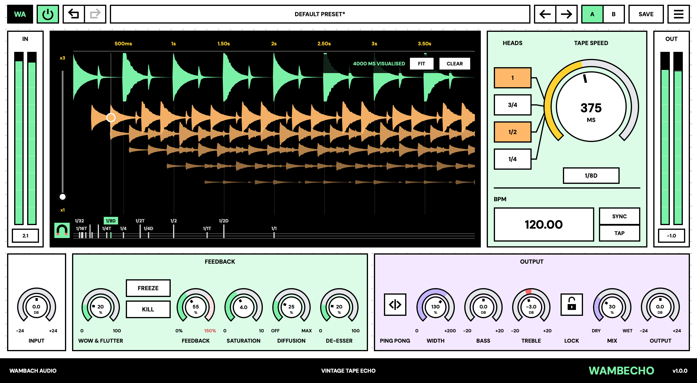

[WambEcho-mac.pkg](https://github.com/scwambach/wambach-audio-releases/releases/download/wamb-echo-latest/WambEcho-mac.pkg) | [WambEcho-win.exe](https://github.com/scwambach/wambach-audio-releases/releases/download/wamb-echo-latest/WambEcho-win.exe)

## WambOxford Dynamic EQ

A five-band dynamic EQ: each band can boost or cut only when the signal
crosses its threshold, with an optional external sidechain.

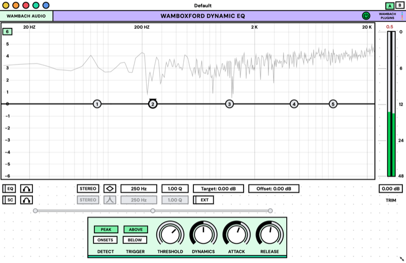

[WambOxfordDynamicEQ-mac.pkg](https://github.com/scwambach/wambach-audio-releases/releases/download/wamboxford-dynamic-eq-latest/WambOxfordDynamicEQ-mac.pkg) | [WambOxfordDynamicEQ-win.exe](https://github.com/scwambach/wambach-audio-releases/releases/download/wamboxford-dynamic-eq-latest/WambOxfordDynamicEQ-win.exe)

Older versions are listed on the [Releases](https://github.com/scwambach/wambach-audio-releases/releases) page.
