# Wambach Audio plugin downloads

Installers for Wambach Audio plugins.

- **macOS** (`.pkg`): Audio Unit, VST3 and standalone app. Runs on Apple
  Silicon and Intel Macs, macOS 11 or later.
- **Windows** (`.exe`): VST3 and standalone app. 64-bit Windows.

## Chugs Virtual Drummer

A multi-mic, round-robin drum sampler. Ten pads with their own close and
overhead mic mixes, played as one stereo kit or split out to separate
channels. The installer also installs the drum sample library (about 200 MB
once installed).

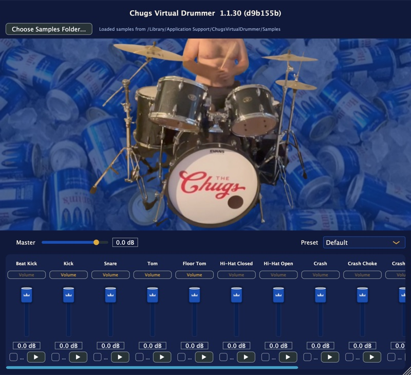

[ChugsVirtualDrummer-mac.pkg](https://github.com/scwambach/wambach-audio-releases/releases/download/chugs-virtual-drummer-latest/ChugsVirtualDrummer-mac.pkg) | [ChugsVirtualDrummer-win.exe](https://github.com/scwambach/wambach-audio-releases/releases/download/chugs-virtual-drummer-latest/ChugsVirtualDrummer-win.exe)

## Cut It

A noise reducer for steady background noise such as tape hiss, air
conditioning and ventilation. Play it a short noise-only section to learn
the noise, then dial in how much to remove. A Difference switch lets you
hear exactly what's being taken out.

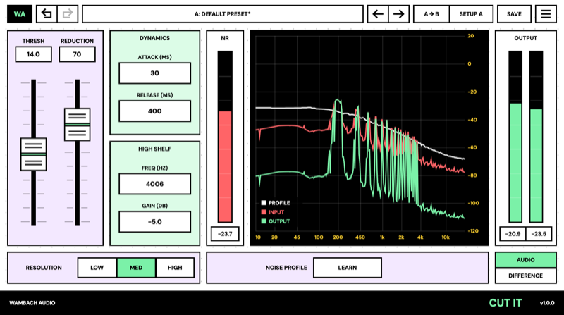

[CutIt-mac.pkg](https://github.com/scwambach/wambach-audio-releases/releases/download/cut-it-latest/CutIt-mac.pkg) | [CutIt-win.exe](https://github.com/scwambach/wambach-audio-releases/releases/download/cut-it-latest/CutIt-win.exe)

## FirePressor

A channel strip with a tube preamp and a limiter: input trim, drive,
threshold and makeup, plus an 80 Hz filter.

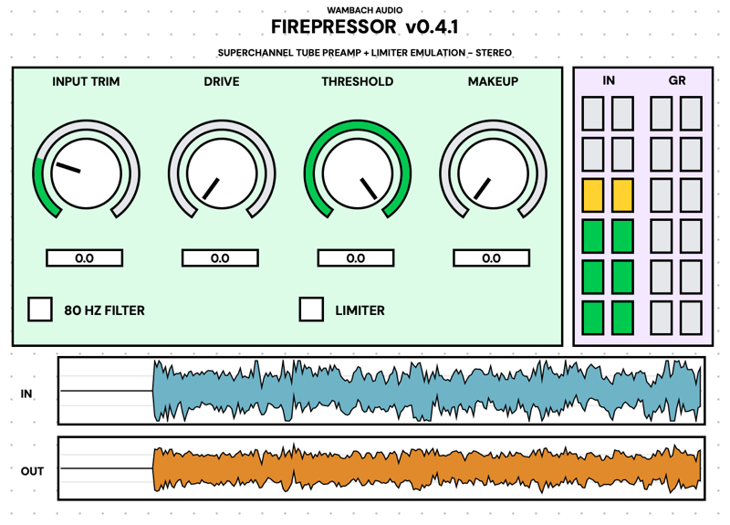

[FirePressor-mac.pkg](https://github.com/scwambach/wambach-audio-releases/releases/download/fire-pressor-latest/FirePressor-mac.pkg) | [FirePressor-win.exe](https://github.com/scwambach/wambach-audio-releases/releases/download/fire-pressor-latest/FirePressor-win.exe)

## Get The Ess Outta Here

A de-esser that tames harsh "s" sounds, with a live graph showing what gets
reduced. Mono or stereo.

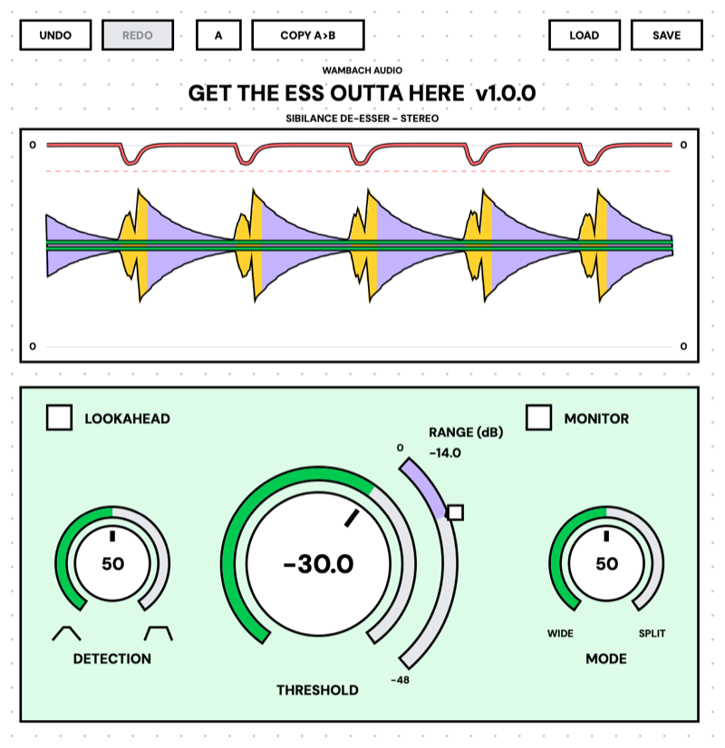

[GetTheEssOuttaHere-mac.pkg](https://github.com/scwambach/wambach-audio-releases/releases/download/get-the-ess-outta-here-latest/GetTheEssOuttaHere-mac.pkg) | [GetTheEssOuttaHere-win.exe](https://github.com/scwambach/wambach-audio-releases/releases/download/get-the-ess-outta-here-latest/GetTheEssOuttaHere-win.exe)

## Make Big

A one-window mastering processor: tone, dynamics, saturation, width and
loudness, with full metering.

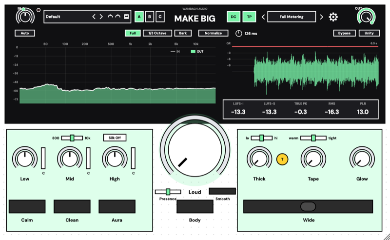

[MakeBig-mac.pkg](https://github.com/scwambach/wambach-audio-releases/releases/download/make-big-latest/MakeBig-mac.pkg) | [MakeBig-win.exe](https://github.com/scwambach/wambach-audio-releases/releases/download/make-big-latest/MakeBig-win.exe)

## Referencer

A reference-track A/B tool for the end of your master bus. Flip between your
mix and a commercial track while comparing spectrum, loudness and stereo
meters side by side.

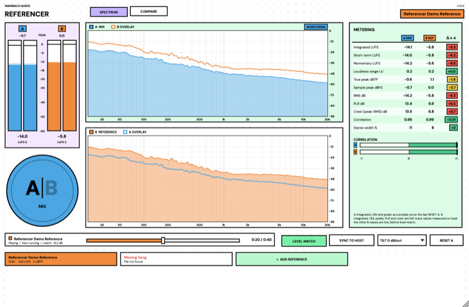

[Referencer-mac.pkg](https://github.com/scwambach/wambach-audio-releases/releases/download/referencer-latest/Referencer-mac.pkg) | [Referencer-win.exe](https://github.com/scwambach/wambach-audio-releases/releases/download/referencer-latest/Referencer-win.exe)

## Stop Crowdin' Me

Makes room for a vocal in a busy mix. Put it on the guitars or music bus and
feed it the vocal: it dips the music only in the frequencies the vocal is
using, only while the vocal is there. Plugin only, no standalone app.

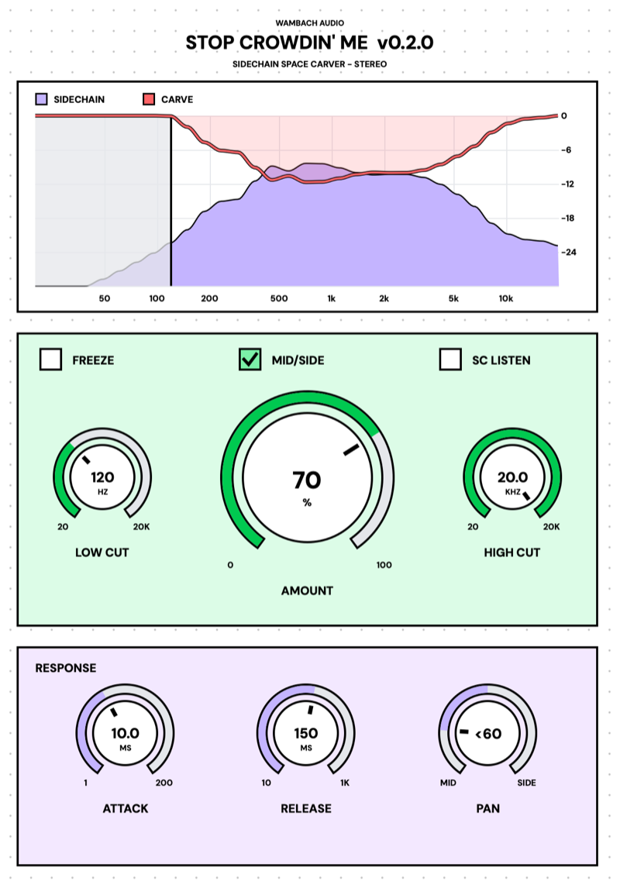

[StopCrowdinMe-mac.pkg](https://github.com/scwambach/wambach-audio-releases/releases/download/stop-crowdin-me-latest/StopCrowdinMe-mac.pkg) | [StopCrowdinMe-win.exe](https://github.com/scwambach/wambach-audio-releases/releases/download/stop-crowdin-me-latest/StopCrowdinMe-win.exe)

## StressedOut

A character compressor with eight curves, from a gentle 1:1 up to an all-out
"Nuke", plus a before/after display of what it's doing.

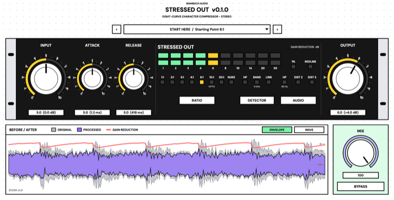

[StressedOut-mac.pkg](https://github.com/scwambach/wambach-audio-releases/releases/download/stressed-out-latest/StressedOut-mac.pkg) | [StressedOut-win.exe](https://github.com/scwambach/wambach-audio-releases/releases/download/stressed-out-latest/StressedOut-win.exe)

## Verbox SCW85

A digital reverb and effects processor based on a classic rack unit, with
several algorithms. A Simple view keeps it to decay, size, pre-delay, tone
and mix; the Advanced view gives detailed control over decay, diffusion and
tone.

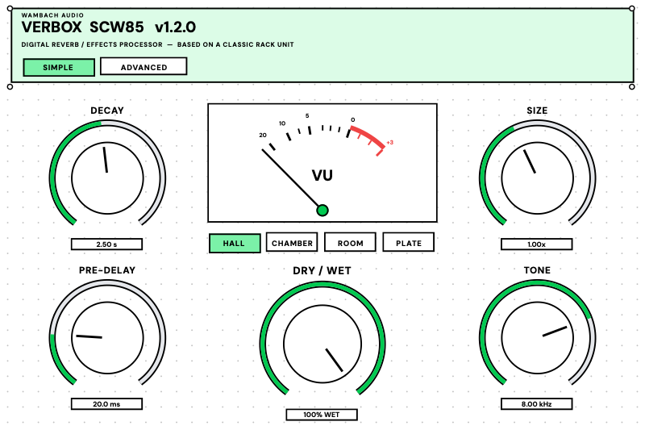

[VerboxSCW85-mac.pkg](https://github.com/scwambach/wambach-audio-releases/releases/download/verbox-scw85-latest/VerboxSCW85-mac.pkg) | [VerboxSCW85-win.exe](https://github.com/scwambach/wambach-audio-releases/releases/download/verbox-scw85-latest/VerboxSCW85-win.exe)

## Vintage Tape

A reel-to-reel tape machine for the master bus or any track: saturation,
compression, head bump, wow and flutter, hiss and worn-tape character.

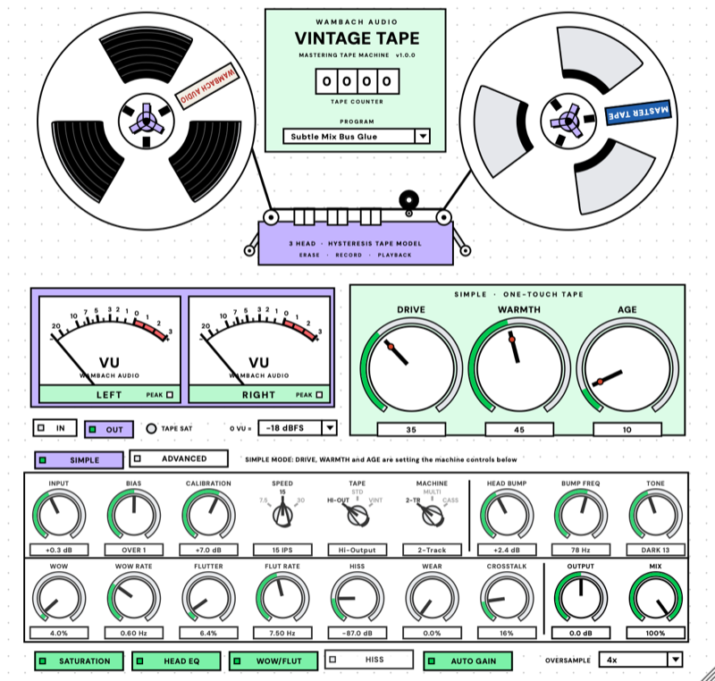

[VintageTape-mac.pkg](https://github.com/scwambach/wambach-audio-releases/releases/download/vintage-tape-latest/VintageTape-mac.pkg) | [VintageTape-win.exe](https://github.com/scwambach/wambach-audio-releases/releases/download/vintage-tape-latest/VintageTape-win.exe)

## VocalDoubler

Turns a single vocal into a wider, thicker double with up to four voices,
each with its own gain, pan, delay, detune and modulation. Plugin only, no
standalone app.

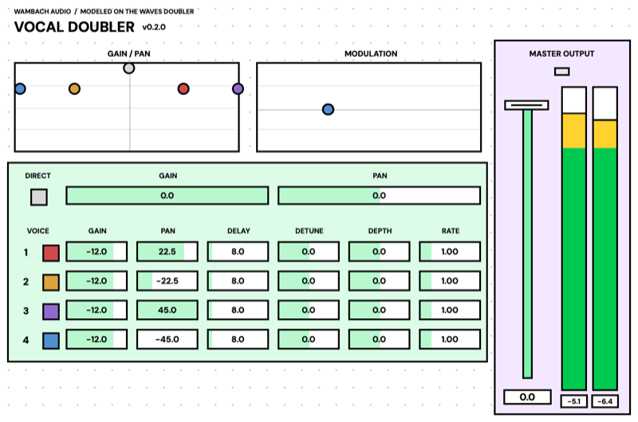

[VocalDoubler-mac.pkg](https://github.com/scwambach/wambach-audio-releases/releases/download/wamvox-doubler-latest/VocalDoubler-mac.pkg) | [VocalDoubler-win.exe](https://github.com/scwambach/wambach-audio-releases/releases/download/wamvox-doubler-latest/VocalDoubler-win.exe)

## WambEcho

A vintage tape echo with four switchable tape heads, wow and flutter,
saturation, a de-esser, diffusion reverb and true ping pong. A waveform
visualiser shows where every repeat lands, and delay times snap to note
values. macOS only for now; the Windows installer will follow.

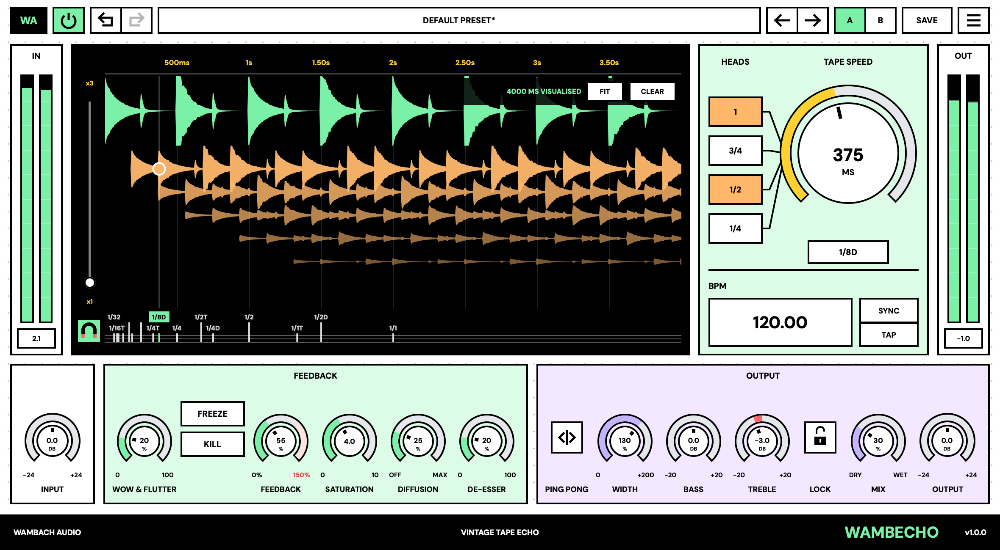

[WambEcho-mac.pkg](https://github.com/scwambach/wambach-audio-releases/releases/download/wamb-echo-latest/WambEcho-mac.pkg)

## WambOxford Dynamic EQ

A five-band dynamic EQ: each band can boost or cut only when the signal
crosses its threshold, with an optional external sidechain.

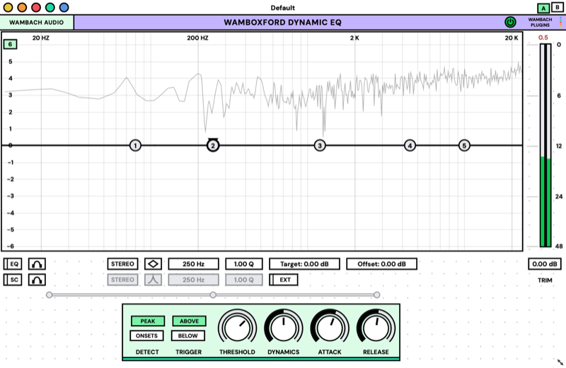

[WambOxfordDynamicEQ-mac.pkg](https://github.com/scwambach/wambach-audio-releases/releases/download/wamboxford-dynamic-eq-latest/WambOxfordDynamicEQ-mac.pkg) | [WambOxfordDynamicEQ-win.exe](https://github.com/scwambach/wambach-audio-releases/releases/download/wamboxford-dynamic-eq-latest/WambOxfordDynamicEQ-win.exe)

Older versions are listed on the [Releases](https://github.com/scwambach/wambach-audio-releases/releases) page.
